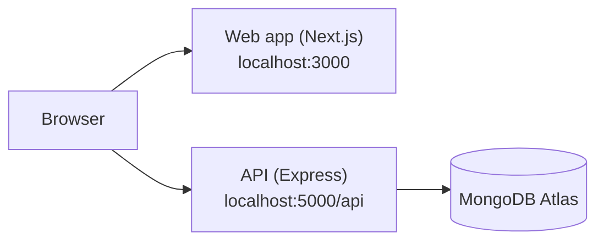
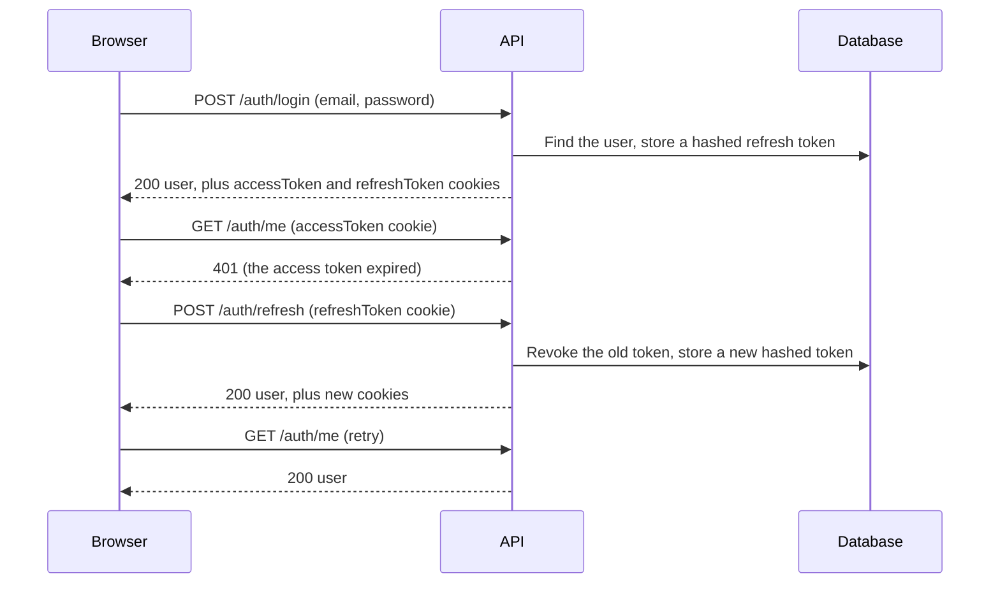

# Architecture

Barter Hub has two applications in one repository: a Next.js web app in `client/` and an Express API in `server/`. The API stores data in MongoDB Atlas. This document explains how the parts fit together and why the code is organized the way it is.

## The big picture

The web app serves pages. The code that runs in the browser calls the API directly with `fetch`. Login sessions travel in cookies, so the browser sends them automatically on each call.

## The API

### Layers

Every request moves through the same layers. Each layer has one job.

| Layer | Folder | Job |
| --- | --- | --- |
| Route | `routes/` | Maps a URL and method to a list of middleware and a controller |
| Validation | `middleware/validate.js` | Checks the request against a Zod schema and rejects bad input |
| Controller | `controllers/` | Reads the validated request, calls a service, and sends the response |
| Service | `services/` | Holds the business rules. It knows nothing about HTTP. |
| Model | `models/` | Describes the data and talks to MongoDB |

A service never reads `req` or `res`, so the same logic can be reused from a script or a test. A controller never contains a business rule, so it stays short.

### Middleware order

`app.js` adds middleware in a fixed order. Each request passes through them from top to bottom.

1. `helmet`: adds security headers.
2. `cors`: allows browser calls only from `CLIENT_URL`, with cookies.
3. `express.json`: reads JSON bodies up to 1 MB.
4. `cookie-parser`: reads cookies into `req.cookies`.
5. `morgan`: logs one line per request, except when `NODE_ENV` is `test`.
6. `express-rate-limit`: limits each IP address to 300 requests per 15 minutes.
7. The routes under `/api`.
8. `notFound` and `errorHandler`: turn every failure into a JSON response.

### Errors

Code throws an `ApiError` with an HTTP status and a message. Express 5 forwards errors from `async` functions automatically, so controllers do not need `try/catch`. The error handler also translates known database and parsing errors, for example a duplicate email or invalid JSON, into the right status. Unexpected errors are logged on the server, and the client receives only `Internal server error`. See the [API overview](api/overview.md#errors) for the response format.

### Data

| Collection | Model | Holds |
| --- | --- | --- |
| `users` | `User` | Name, email, password hash, role, status, bio, city |
| `refreshtokens` | `RefreshToken` | Hashed refresh tokens, one per login session |
| `categories` | `Category` | The category list, with a `kind` of `item` or `service` and an optional parent |

## Sessions

Barter Hub uses two tokens, both stored in `httpOnly` cookies. The reasoning is in [decision 0003](decisions/0003-two-token-sessions.md), and the protections are in the [security notes](security.md).

## The web app

### Pages and layouts

The web app uses the Next.js App Router. A folder is a route, and `page.js` is the page. Folders in parentheses are route groups. They organize files without changing the URL.

| Group | Pages | Layout |
| --- | --- | --- |
| `(site)` | Home (`/`) and the account page (`/account`) | Header, main content, and footer |
| `(auth)` | `/login` and `/register` | A minimal layout with only the site name |

Pages are server components by default, which means they render on the server and search engines can read them. Only the parts that need the browser, such as forms and the header, are client components marked with `'use client'`.

### Talking to the API

All calls go through one helper, `src/lib/api.js`.

- It sends cookies with every request (`credentials: 'include'`).
- It converts failures into an `ApiError` with a status, a message, and optional field errors.
- When a request returns 401, it asks the API for new tokens and repeats the request once. Concurrent requests share one refresh call, and browser tabs take turns by using the Web Locks API, because a refresh token can be used only once.
- If the refresh fails, it dispatches an `auth:expired` event so the interface switches to the logged-out state.

Calls for each area live in small files such as `auth-api.js` and `user-api.js`, so screens never build URLs themselves.

### Session state

`AuthProvider` holds who is logged in. When the app loads, it calls `GET /auth/me` and sets the state to `authenticated` or `anonymous`. The header and any page can read the state with the `useAuth` hook. The `RequireAuth` component wraps pages that need a login and redirects anonymous visitors to `/login?next=<path>`. After login, `safeRedirectPath` accepts only paths on the same site, which prevents open redirects.

The login check in the browser is a convenience for the user. The API is the real protection, because it rejects every protected request that has no valid cookie.

### Forms

Forms use React Hook Form with a Zod schema from `src/lib/validation.js`. The schemas repeat the API rules so people get instant feedback. The API always validates again. When the API returns field errors, `applyApiErrors` shows each message under the matching input.

### Design system

Colors, fonts, spacing, and shapes are defined as tokens in `src/app/globals.css`. See [decision 0004](decisions/0004-design-tokens.md). Components in `src/components/ui` use only the meaning-based token names, for example `bg-primary`, so the look can change in one place.

## What is not built yet

Listings, images, search, offers, chat, notifications, reviews, reports, and AI features are planned. They will follow the same layers: a route, validation, a controller, a service, and a model.
